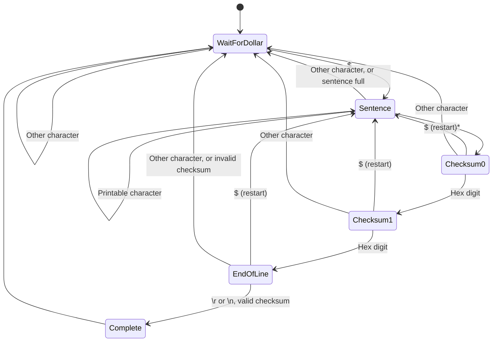

# NMEA parser

NMEA 0183 sentences look like

| `$` | talker (2 chars) + type (3 chars) | `,field,field,...` | `*` | checksum (2 hex chars) | `\r\n` |
|-----|-----------------------------------|--------------------|-----|------------------------|--------|

e.g., `$GPGGA,123519,4807.038,N,01131.000,E,1,08,0.9,545.4,M,46.9,M,,*47`, where the checksum
is the XOR of all characters between `$` and `*`. The checksum is mandatory, and either `\r` or
`\n` ends the sentence.

The receive state machine is shown below. Each state waits for a character: `Evaluate()` peeks
at it to choose the transition, and `Exit()` consumes it. A `$` anywhere restarts the sentence,
so a truncated sentence doesn't hide the one following it. Other unexpected characters, or a
too long sentence, drop the sentence.

`Complete` parses the sentence, and merges the data with other sentences in the same
`PushData()` call.

